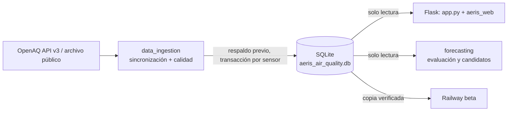

# AERIS

Observatorio de calidad del aire (PM2.5) para Querétaro. Recopila mediciones
horarias públicas de OpenAQ, evalúa su calidad sin alterar los valores
originales y las presenta en un dashboard web de solo lectura.

**Autor:** David Israel Atilano Quiroz

## Estado actual

- **Datos:** mediciones horarias de PM2.5 de OpenAQ (API v3 y archivo público
  `OpenAQ-Archive`, conservados como fuentes separadas) en SQLite.
- **Dashboard:** `/v2` (vista ciudadana) y `/v2/datos` (explorador técnico).
  La vista anterior sigue en `/`.
- **Beta pública:** Railway, sirviendo una copia fija de la base verificada por SHA-256.
- **Pronóstico:** modelos candidatos a 1, 6 y 24 h **sin validación final**.
  La prueba prospectiva está reservada del 19/10/2026 al 19/11/2026; el
  dashboard no publica predicciones.

## Arquitectura



| Carpeta | Contenido |
|---|---|
| `data_ingestion/` | Sincronización OpenAQ, archivo histórico, calidad versionada, catálogo de sensores, retención de respaldos y tarea programada de Windows |
| `aeris_web/`, `templates/`, `static/v2/` | Dashboard v2 y configuración del perfil beta |
| `app.py`, `wsgi.py` | Aplicación Flask (vista anterior y registro de la v2) y punto de entrada de Gunicorn |
| `forecasting/` | Preparación horaria, evaluación, selección, artefactos versionados, inferencia y prueba final |
| `scripts/` | Utilidades de operación, auditoría y verificación |
| `tests/` | Pruebas sin red; usan bases temporales y respuestas simuladas |
| `docs/` | Documentación técnica (ver [índice](#documentación)) |

**Tecnologías:** Python, Flask, SQLite, pandas, scikit-learn, Chart.js, Leaflet,
Gunicorn, Docker y Railway.

## Ejecutar localmente

```powershell
python -m venv .venv
.\.venv\Scripts\python.exe -m pip install -r requirements.txt
.\.venv\Scripts\python.exe app.py
```

Abrir http://localhost:5000/v2. Requiere una base en `data/aeris_air_quality.db`
(no incluida en Git); `AERIS_DB_PATH` permite usar otra. Flask nunca descarga,
entrena ni escribe en la base.

## Pruebas

```powershell
.\.venv\Scripts\python.exe -B -m unittest discover -s tests -v
```

No consultan OpenAQ ni abren la base del proyecto. También se ejecutan en
GitHub Actions en cada push y pull request.

## Operación

Los comandos de red requieren `OPENAQ_API_KEY` (nunca en Git) y se ejecutan
manualmente o desde la tarea programada; ninguno corre al iniciar Flask.

```powershell
# Actualización incremental (48 h de solapamiento para correcciones)
.\.venv\Scripts\python.exe -B -m data_ingestion.sync_pm25_queretaro --incremental

# Plan de recuperación de huecos, sin red
.\.venv\Scripts\python.exe -B -m data_ingestion.plan_recovery --sensor 2694071 --from 2026-10-01 --to 2026-10-08

# Retención de respaldos (sin --apply solo lista)
.\.venv\Scripts\python.exe -B -m scripts.prune_backups
```

Cada sincronización crea primero un respaldo en `data/backups/`, registra su
ejecución en `ingestas` y conserva las discrepancias como candidatas sin
sobrescribir el valor original. La sincronización programada
(`data_ingestion.scheduled_sync`) aplica después la retención: conserva los 5
respaldos rutinarios más recientes y el último de cada día durante 14 días;
los respaldos de hitos nunca se eliminan.

Detalle completo de ingesta, calidad, recuperación y pronóstico en
[operación detallada](docs/operacion.md).

## Despliegue

- **Docker:** `Dockerfile` instala solo `requirements-web-linux.lock` (con hashes)
  y ejecuta Gunicorn como usuario sin privilegios. `compose.beta.yaml` levanta la
  beta local con la copia de la base montada en solo lectura.
- **Railway:** `railway_start.py` verifica el hash e integridad de la copia
  subida, restringe permisos y cede privilegios antes de iniciar Gunicorn.
  Healthcheck en `/health/ready`.

Ver [plan de despliegue](docs/aeris_web_deployment_plan.md) y
[preparación para Railway](docs/aeris_railway_deployment_readiness.md).

## Documentación

| Tema | Documentos |
|---|---|
| Operación general | [Operación detallada](docs/operacion.md) · [Recopilación automatizada](docs/automated_collection.md) · [Actualización controlada](docs/controlled_update.md) · [Programador Python directo](docs/direct_python_scheduler.md) · [Preparación del programador](docs/scheduler_readiness.md) |
| Datos y calidad | [Fuentes históricas](docs/historical_sources.md) · [Calidad versionada](docs/versioned_quality.md) · [Verificación de la API](docs/live_api_verification.md) · [Plan de expansión](docs/aeris_data_expansion_plan.md) · [Visibilidad por lotes](docs/aeris_batch_visibility_validation.md) |
| Archivo histórico | [Ensayo de importación](docs/aeris_archive_import_dry_run.md) · [Preparación para producción](docs/aeris_archive_production_readiness.md) |
| Pronóstico | [Sistema de predicción](docs/prediction_system.md) · [Evaluación predictiva](docs/predictive_evaluation.md) |
| Dashboard | [Plan v2](docs/dashboard_v2_plan.md) · [Implementación v2](docs/dashboard_v2_implementation.md) · [v2.1](docs/dashboard_v21_implementation.md) · [Experiencia pública v2.1](docs/dashboard_v21_public_experience.md) · [v2.2](docs/dashboard_v22_implementation.md) · [Propuesta de rediseño](docs/aeris_research_redesign_proposal.md) |
| Despliegue | [Plan web](docs/aeris_web_deployment_plan.md) · [Validación beta](docs/aeris_web_beta_validation.md) · [Preparación Railway](docs/aeris_railway_deployment_readiness.md) · [Primer despliegue](docs/aeris_railway_first_deployment_debug.md) · [Snapshot demo](docs/aeris_railway_demo_snapshot.md) · [Demo 22/10/2026](docs/aeris_railway_demo_20261022.md) |

## Limitaciones

OpenAQ es la vía de consulta; el operador y la procedencia primaria de cada
sensor requieren verificación documental. Los marcadores del mapa son
coordenadas reportadas, no una superficie de contaminación. Las alertas de
calidad (`aeris_qc_v2`) señalan revisión, no errores confirmados. El CSV de
2022 permanece separado por procedencia y zona horaria no verificadas.
