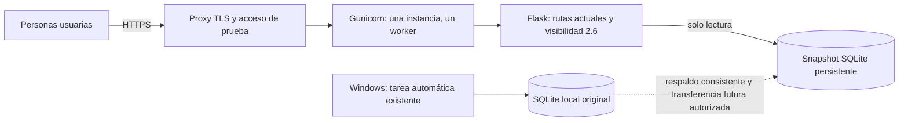

# AERIS 3.0 — plan de preparación para despliegue web

Fecha de revisión: **18-oct-2026, hora de Querétaro**. Alcance: auditoría y diseño; **no se implementó configuración, se instaló infraestructura ni se desplegó un servicio**. La importación histórica productiva permanece en **NO-GO**.

## 1. Recomendación

Primera versión de prueba: **una instancia Linux, proxy HTTPS, Gunicorn y Flask de solo lectura sobre una copia consistente y versionada de SQLite en almacenamiento persistente**. Sin clave OpenAQ, sincronizador, modelos ni importadores habilitados en el proceso web.

Recomiendo un **VPS pequeño con disco local persistente** si se busca continuidad posterior con SQLite y procesos separados en el mismo host. Render de pago es una alternativa más administrada para la primera web con snapshot, pero su disco no puede compartirse con un worker independiente. No se recomienda empezar migrando datos a PostgreSQL ni cambiando el sincronizador local: ampliaría el alcance y exigiría revalidar consultas y contratos científicos.



La flecha de publicación es un procedimiento propuesto, **no una sincronización ni transferencia realizada**. La tarea de Windows conserva su programación, credenciales y base. La web de prueba muestra un corte real y su antigüedad; no anuncia datos en vivo. Una futura actualización del snapshot o un recolector Linux requerirá autorización separada.

## 2. Auditoría de la aplicación actual

| Componente | Estado comprobado | Implicación para Linux |
|---|---|---|
| `app.py` | Objeto global `app = Flask(__name__)`; registro del blueprint v2 al importar | Entrada WSGI válida `app:app`; no exige factory para el primer despliegue |
| Servidor de desarrollo | `app.run` solo bajo `__main__`, bind `127.0.0.1`, puerto por `PORT`, `debug=False` | Gunicorn no ejecuta ese bloque; el bind/puerto de Gunicorn debe configurarse aparte |
| Configuración de datos | `DB = ROOT / 'data/aeris_air_quality.db'` | Aún no existe `AERIS_DB_PATH`; hay que introducirla con valor local compatible y validación de ruta |
| `/` | HTML/CSS/JS embebidos mediante `render_template_string` | Funciona, pero dificulta CSP estricta y mantenimiento; conservarlo inicialmente |
| `/v2`, `/v2/datos` | Jinja en `templates/v2`, CSS/JS y bibliotecas en `static/v2` | Estructura portable, sin necesidad de reconstrucción frontend |
| Lectura SQLite | Política central de 2.6, URI `mode=ro`, transacción por conexión y `query_only` | Preservar vistas/tablas TEMP; no reemplazarla por conexiones directas al desplegar |
| Catálogo | Tabla `sensores`; fallback a `data/openaq_stations.json` | Incluir el catálogo verificable si se utiliza el fallback; no crear metadatos ficticios |
| Investigación y modelos | En módulos separados; no importados por el arranque web auditado | No deben ejecutarse al arrancar WSGI ni incluirse como requisito del servicio web mínimo |
| Git | Cambios existentes y numerosos archivos sin seguimiento | Todavía no hay una entrega de código limpia y reproducible para desplegar; no publicar todo el workspace |

Rutas registradas: `/`, `/logo.png`, `/static/<path:filename>`, `/health`, `/api/overview`, `/api/measurements`, `/api/comparison`, `/api/export.csv`, `/v2` y `/v2/`, `/v2/datos` y `/v2/datos/`, `/api/v2/observations`, `/api/v2/stations`, `/api/v2/public`, `/api/v2/comparison`. Todas son GET, HEAD y OPTIONS automáticos; no se identificaron rutas HTTP para sincronizar, importar, administrar tareas o predecir.

### Dependencias

`requirements.txt` mezcla Flask y Gunicorn con pandas, NumPy, scikit-learn, joblib, matplotlib y azure-storage-blob, **sin fijar versiones**. `requirements-dev.txt` fija `websocket-client==1.9.0` para herramientas de navegador. No se encontraron Dockerfile, configuración Gunicorn ni módulo WSGI independiente.

Entorno inspeccionado: Python **3.15.0**, Flask **3.1.3**, Gunicorn instalado **26.2.0**, SQLite **3.53.4**; pandas 3.0.6, NumPy 2.5.4, scikit-learn 1.9.1 y joblib 1.6.0. Son versiones observadas, no una matriz Linux certificada. El arranque de `app` no importó pandas, NumPy, sklearn, joblib, matplotlib, Azure ni el módulo de credenciales Windows.

Propuesta futura: separar dependencias `web`, `ingestion`, `research` y `dev`; para web bastan Flask, Gunicorn y disponibilidad de datos IANA de zonas horarias, más sus dependencias transitivas. Fijar versiones y hashes resueltos en Linux; no copiar `.venv` de Windows ni convertir un `pip freeze` local en una garantía de portabilidad. Validar primero CPython 3.13 y contrastar con la versión local; elegir la versión exacta según soporte y resultados reales, sin modificar artefactos científicos.

`zoneinfo` obtiene zonas del sistema o de `tzdata`; debe comprobarse `America/Mexico_City`. Mantener cómputo UTC y conversión local explícita, sin sustituir reglas históricas por un offset fijo. [Documentación Python](https://docs.python.org/3.13/library/zoneinfo.html).

## 3. Dependencias de Windows y alcance de la portabilidad

| Dependencia | Localización / uso | Tratamiento propuesto |
|---|---|---|
| DPAPI y SecureString CLIXML | `windows_credentials.py`, `scheduled_sync.main` | No portables como mecanismo de secreto Linux. No copiar `.secrets` ni descifrar/exportar la clave para la web |
| Task Scheduler, COM, `schtasks.exe`, `powershell.exe` | Instalación, supervisión, comparación semántica y activación de tareas | Permanecen en Windows; no se ejecutan ni forman parte del arranque web |
| Python absoluto de `.venv\Scripts\python.exe` y directorios de usuario | XML y documentación de la tarea preparada | No trasladarlos; Linux usa su propio entorno y rutas configuradas |
| Chrome en `C:/Program Files/Google/Chrome/Application/chrome.exe` | Herramientas de preview y pruebas de navegador | Parametrizar navegador o usar un runner Linux de pruebas; no empaquetar esos scripts como servicio |
| `msvcrt.locking` | `operations.exclusive_lock` en Windows | Ya existe rama POSIX con `fcntl.flock`; probarla en procesos Linux independientes antes de autorizar un escritor |
| Rutas Windows en evidencias históricas | Columnas de procedencia y reportes | Conservar originales como evidencia; no intentar abrirlas como rutas Linux. Crear un mapeo documentado si después se migra el archivo de evidencias |

El import de Flask no depende de DPAPI. En cambio, **el CLI `scheduled_sync.main` sí exige DPAPI**: no es correcto cambiar su comando a Linux y declararlo compatible. Su función controlada `run` recibe la clave por argumento y podría reutilizarse con una entrada Linux independiente, previa revisión de garantías y pruebas. No sustituirla simplemente por el CLI de operaciones que omita los controles de preservación del supervisor.

## 4. Compatibilidad WSGI/Gunicorn: verificado y pendiente

Se comprobó `callable(app.app) == True`. El cliente WSGI local devolvió HTTP 200 para `/`, `/v2`, `/v2/datos`, CSS principal y JavaScript ciudadano. `DEBUG=False`, `TESTING=False`. No se expuso un puerto ni se ejecutó un servidor público.

Flask documenta la entrada `módulo:objeto` y que Gunicorn no funciona de forma nativa en Windows. **No se ejecutó Gunicorn en Linux ni se certificó aún su funcionamiento real allí**. Tener su distribución instalada localmente no prueba eso. [Gunicorn en Flask](https://flask.palletsprojects.com/en/stable/deploying/gunicorn/).

Comando inicial propuesto, para un VPS y solo después de preparar/configurar el entorno:

```bash
gunicorn --bind 127.0.0.1:8000 --workers 1 --worker-class gthread --threads 2 \
  --timeout 60 --access-logfile - --error-logfile - app:app
```

Es diseño, **no un comando ejecutado**. Una instancia significa un único servicio web; un worker es un proceso dentro de ese servicio. Dos threads son una hipótesis inicial que se medirá, no una capacidad demostrada. Cada petición conserva su conexión SQLite independiente; no mantener conexiones abiertas antes de un fork. En PaaS se adaptaría el bind al puerto asignado por la plataforma, sin eludir su proxy.

No usar el servidor de desarrollo para la prueba pública ni ejecutar Gunicorn como root. Mantener el puerto interno sin acceso directo desde Internet. [Despliegue Flask](https://flask.palletsprojects.com/en/stable/deploying/).

## 5. Configuración por entorno propuesta

**Estas variables AERIS todavía no están implementadas.** La primera implementación deberá preservar el funcionamiento local cuando no estén definidas y rechazar configuraciones de staging inseguras o incompletas.

| Variable | Rol / ejemplo no secreto | Regla |
|---|---|---|
| `AERIS_ENV` | `local` o `staging` | No sustituye el control explícito `DEBUG=False` |
| `AERIS_DB_PATH` | `/var/lib/aeris/snapshots/<corte>/aeris.db` | Ruta absoluta a una copia existente; nunca crear una base vacía automáticamente |
| `AERIS_DATASET_MANIFEST` | Ruta del manifiesto de corte | Identidad del snapshot, UTC, fuente, esquema, hash y revisión de código; sin secretos |
| `AERIS_TRUSTED_HOSTS` | Dominio autorizado de prueba | Convertir/validar lista para `TRUSTED_HOSTS`; no confiar en cualquier Host |
| `AERIS_PROXY_HOPS` | Conteo acordado con la infraestructura | Solo aplicar ProxyFix detrás del proxy real y con conteos verificados |
| `AERIS_LOG_LEVEL` | `INFO` | No volcar entorno, cabeceras de autorización ni cuerpos con secretos |
| `PORT` / opciones Gunicorn | Puerto proporcionado por el host | El `PORT` actual solo afecta `app.run`; integrar correctamente el arranque WSGI futuro |
| `OPENAQ_API_KEY` | **Ausente en web** | Exclusiva de un recolector futuro autorizado, mediante gestor de secretos o archivo protegido |
| `AERIS_SECRET_KEY` | Solo si después se añaden sesiones | Obtener del gestor; no inventar una clave fija ni añadirla al código |

No existe hoy una función que convierta esas variables en configuración. Proponer un módulo pequeño de configuración o factory compatible, evitando una refactorización completa de `app.py` antes de tener pruebas. No crear variables que permitan habilitar importación histórica o predicciones saltándose sus NO-GO.

En web no se necesita clave OpenAQ para consultar SQLite. No se requieren sesiones Flask actualmente y `SECRET_KEY` está sin configurar: no es un fallo de cifrado de sesiones en uso, pero debe resolverse si se introduce autenticación basada en cookies. Para la primera beta puede emplearse control de acceso en el proxy, con su secreto fuera del repositorio. No usar `FLASK_ENV` como sustituto de configuración ni imprimir secretos para verificarlos.

## 6. SQLite persistente y separación de responsabilidades

Medición de solo lectura en esta auditoría: **12,536 registros**, archivo de **19,484,672 bytes**, `journal_mode=delete`, JSON y funciones de ventana disponibles. SHA-256 idéntico antes/después de la lectura. No se cambió journal, esquema, datos ni configuración de SQLite.

Para una beta pequeña de lectura, SQLite es una opción razonable de partida; falta medir RSS, tiempos y concurrencia. El tamaño de archivo no predice por sí solo memoria o carga: `/` carga todas las mediciones y construye resúmenes en Python; CSV y periodos completos pueden ser costosos. V2 limita el número de filas, pero eso no protege todos los endpoints originales.

### Primera beta: copia publicada de solo lectura

- Código versionado e inmutable, datos fuera de la release y de `static/`.
- Base publicada en disco persistente local del servidor; usuario web con lectura del snapshot y permisos para sus propios temporales, no escritura sobre datos/evidencias.
- Lectores 2.6 intactos, con objetos TEMP privados aunque `main` sea de solo lectura. No convertir toda la conexión en `immutable=1` indiscriminadamente.
- Copia mediante **SQLite Backup API**, cierre, integridad/FK, hashes y transferencia cifrada futura autorizada. No hacer `cp`/SFTP del archivo vivo como si fuera siempre consistente. [Backup API](https://sqlite.org/backup.html).
- Cada publicación recibe una ruta de versión nueva y manifiesto. Reiniciar/controlar conexiones para seleccionar el nuevo corte; no sobrescribir ni renombrar un archivo SQLite que tiene conexiones activas. [Riesgos de copia/renombrado](https://www.sqlite.org/howtocorrupt.html).
- El snapshot conserva todas las tablas de calidad/ledger y sus estados, no solo `mediciones`; exportar una tabla omitiría la política de visibilidad.

### Futuro recolector Linux, fuera de esta autorización

Procesos y permisos separados: `aeris-web` solo lee; `aeris-ingest` puede escribir la base de prueba y evidencias; un proceso de respaldo escribe en otro destino. Una sola base por entorno y un solo escritor controlado. El recolector no arranca desde Flask, Gunicorn, un endpoint o el mecanismo de import de módulos.

En un VPS podrían compartir el **mismo disco local** y el bloqueo canónico `<db>.sync.lock`, usando la rama POSIX ya existente. Su cron/systemd timer Linux sería independiente, pendiente de autorización; no sustituye ni detiene la tarea Windows. Para pruebas debe utilizar otra base y definir autoridad/linaje para no confundir resultados de dos entornos.

WAL es una opción futura de concurrencia, no un requisito para esta beta y **no se activó**. Requiere procesos en el mismo host, planificación de checkpoints y permisos adecuados para `-wal`/`-shm`; no funciona compartiendo el archivo entre máquinas por un filesystem de red. No usar `immutable=1` en una base que cambia. Se debe probar lectura con los permisos reales elegidos, incluyendo archivos auxiliares. [SQLite WAL](https://www.sqlite.org/wal.html).

No montar SQLite por SMB/NFS, no almacenarlo como objeto remoto para abrirlo directamente y no intentar compartirlo entre réplicas web. Si se necesitan varias instancias, múltiples escritores o alta disponibilidad, diseñar una migración aparte a un servicio de base de datos, conservando contratos, claves, procedencia y calidad.

## 7. Alojamiento y costos verificables

Precios consultados el **18-oct-2026, hora de Querétaro**, en USD, antes de impuestos/conversión de moneda. Son tarifas publicadas, no una cotización ni contratación. No se incluyen dominio, respaldos externos, egreso adicional o servicios opcionales salvo indicación expresa.

| Opción | Tarifa publicada | Adecuación y límites |
|---|---|---|
| **VPS DigitalOcean Basic** | 1 GiB RAM, 1 vCPU, SSD 25 GiB: **US$6/mes**; 2 GiB/1 vCPU/50 GiB: **US$12/mes** | Recomendación para mantener SQLite y posibilidad de procesos separados en el mismo host. Exige administrar Linux, parches, TLS, firewall y backups. Empezar con 1 GiB solo como hipótesis para web sin ML; medir carga antes de confirmar capacidad. [Precio oficial](https://www.digitalocean.com/pricing/droplets) |
| **Render de pago con disco** | Cómputo de 512 MB: **US$7/mes**; disco **US$0.25/GB/mes** | Ejemplo aritmético con 1 GB: US$7.25 de cómputo+disco, más cargos aplicables. Conveniente para beta de snapshot sin administrar servidor. No afirmar que ese total cubre toda la factura ni que 512 MB bastan sin pruebas. [Precios oficiales](https://render.com/pricing?trk=article-ssr-frontend-pulse_little-text-block) |
| **PythonAnywhere Developer** | **US$10/mes**, 5 GB de disco; existe modalidad gratuita limitada | WSGI administrado; no equivale a controlar Gunicorn como en un VPS. El proveedor permite SQLite pero no lo recomienda como base de producción. Menos adecuado si se busca reproducir exactamente la arquitectura Gunicorn/disco local. [Planes](https://www.pythonanywhere.com/pricing/), [bases disponibles](https://help.pythonanywhere.com/pages/KindsOfDatabases) |

Render: el disco solo existe para una instancia y no es accesible desde otro servicio, worker, cron, build o pre-deploy. Con disco se pierde el despliegue sin interrupción. Por ello **no** se propone un cron Render que escriba el SQLite del servicio web. Usar snapshot o reconsiderar datastore/arquitectura si después se desea recolector independiente. [Restricciones oficiales de discos](https://render.com/docs/disks).

No recomiendo Render gratuito para una SQLite persistente: no admite disco persistente y se suspende tras 15 minutos sin tráfico. Podría mostrar una demo reconstruible, pero perdería archivos modificados y no cumple el diseño de persistencia elegido. [Condiciones del nivel gratuito](https://render.com/docs/free).

No se crean cuentas, recursos ni compromisos de pago. Revalidar precios y límites justo antes de seleccionar proveedor. Una dirección HTTPS pública temporal también cuenta como despliegue y requiere autorización.

## 8. Seguridad y dependencias externas

### Hallazgos actuales

- Debug desactivado; excepciones SQLite y errores habituales se presentan con mensajes controlados. Revisar el resto de errores en Linux sin activar traceback público.
- Endpoints sin autenticación: hoy son de lectura y validan filtros/listas, pero el alcance de CSV y consultas completas exige control de abuso antes de publicar.
- No hay rutas HTTP de entrenamiento, importación, sincronización o administración. Mantener esa separación.
- `.gitignore` ya excluye bases, `.env`, `.secrets`, datos crudos, respaldo y archivos de investigación. Eso no elimina archivos que ya estuvieran versionados ni protege un `COPY . .` indiscriminado.
- V2 dispone de Leaflet/Chart.js locales; el mapa puede consultar teselas externas. El dashboard original depende además de Google Fonts, CDN de Leaflet/Chart.js y un GeoJSON remoto. No presentar toda la plataforma como offline o libre de terceros.

### Controles propuestos antes de exponer la beta

1. HTTPS en proxy/proveedor; Gunicorn como usuario sin privilegios y sin puerto público directo. SSH restringido y logs rotados.
2. Acceso de prueba restringido inicialmente. No registrar contraseñas del proxy ni incluirlas en URLs compartidas.
3. `TRUSTED_HOSTS`, manejo de errores uniforme y límites de solicitudes/concurrencia/rangos/exportación medidos. `MAX_CONTENT_LENGTH` limita cuerpos entrantes, **no** el tamaño de una respuesta CSV.
4. ProxyFix solo con el número de proxies real; las cabeceras reenviadas pueden falsificarse si se confían sin control. [Configuración Flask](https://flask.palletsprojects.com/en/stable/deploying/proxy_fix/).
5. Cabeceras como `nosniff` y política de framing; CSP inicialmente en modo de reporte y después con orígenes/nonce/hash comprobados. El HTML inline de `/` impide copiar una CSP estricta sin probarla. No habilitar CORS global ni abrir rutas de archivos arbitrarios. [Seguridad Flask](https://flask.palletsprojects.com/en/stable/web-security/).
6. Publicar únicamente código y assets necesarios. Excluir `.secrets`, `.env`, `.venv`, modelos, reportes internos, SQLite y cachés de la imagen/build. El snapshot se transfiere después por un canal autorizado, fuera de la imagen y del repositorio. Revisar también historial y archivos ya rastreados antes de publicar código.
7. Bibliotecas locales con atribuciones/licencias conservadas; validar CSP y caída de servicios externos. Para OpenStreetMap mantener atribución, Referer y caché del navegador; no precargar teselas para pruebas o convertirlas en un paquete offline. Su servicio no ofrece SLA. [Política de teselas](https://operations.osmfoundation.org/policies/tiles/).

## 9. Salud, observabilidad y respaldos

**Riesgo concreto:** `/health` actual devuelve 503 cuando los datos superan 48 h o hay calidad pendiente. Si se utiliza sin cambios como liveness de un snapshot, un dataset antiguo podría provocar reinicios de una aplicación sana.

Proponer endpoints nuevos, **todavía no implementados**:

- Liveness: el proceso sirve peticiones, sin llamar OpenAQ ni evaluar frescura.
- Readiness técnica: snapshot montado/legible, esquema y capacidades mínimas disponibles. No ejecutar `integrity_check` completo en cada sondeo.
- Estado de datos: última observación UTC, antigüedad, fuente, calidad pendiente y corte del snapshot; degradación científica separada del estado del proceso. Conservar `/health` y su contrato actual durante la transición.

La antigüedad predictiva permanece en **dos horas**; ni un liveness 200 ni la disponibilidad de HTTPS habilitan pronósticos. Registrar versión de código, dataset/hash, SQLite, zona horaria, latencia/errores, volumen y espacio en disco; nunca entorno completo, credenciales ni claves.

Respaldos propuestos: snapshot inicial verificado, copia antes de cada futura publicación de datos y copia diaria cuando haya un escritor autorizado. Conservación inicial propuesta de 7 diarios y 4 semanales en almacenamiento separado, sujeta a presupuesto. Verificar hashes, integridad/FK y prueba de restauración a **una ruta alternativa**; una política no está probada hasta restaurar. Evitar usar una imagen completa de disco como única garantía de consistencia de la base.

En la beta sin escritor, el peor desfase de datos depende de la cadencia de publicación aún no acordada; no prometer RPO de una hora por existir una tarea Windows. Proponer medir un objetivo inicial de recuperación de 60 minutos; es una meta, no un resultado demostrado.

## 10. Pruebas y criterios de aceptación futuros

No se añadieron pruebas de implementación porque en esta fase solo se crea este documento. El antecedente local sigue siendo **225 pruebas aprobadas en AERIS 2.6**; no se presenta ese número como validación Linux.

| Prueba futura sobre entorno aislado | Criterio |
|---|---|
| Construcción Linux limpia | Versiones fijadas, `pip check`, sin DPAPI/PowerShell ni librerías de investigación necesarias al importar web |
| SQLite y zona horaria | URI ro, `backup`, JSON, funciones de ventana, TEMP y `query_only`; zona `America/Mexico_City` correcta |
| Gunicorn real | `app:app` arranca, responde HTTP, maneja parada/reinicio y usa una instancia; no ejecuta recolector al importar |
| Configuración | Ruta inexistente o inapropiada produce error controlado; staging no crea una DB vacía ni usa producción local por accidente |
| Rutas y assets | `/`, `/v2`, `/v2/datos`, APIs, CSV y assets locales correctos; mayúsculas/minúsculas de Linux verificadas |
| Visibilidad 2.6 | Lote activo/revertido/reactivado, datos posteriores preservados, calidad dependiente pendiente, hash físico inalterado por web |
| Ciencia y filtros | UTC/local, huecos, fuentes, unidades, mínimos de cobertura, extremos y antigüedad conservados; predicciones deshabilitadas |
| Persistencia | Reinicio y redeploy conservan snapshot y manifiesto; filesystem efímero no se confunde con almacenamiento permanente |
| Concurrencia y recursos | Peticiones simultáneas, CSV y rangos amplios; medir p95, RSS, disco, SQLITE_BUSY y no pérdida de lecturas |
| Seguridad | TLS, host/proxy, errores sin stack, acceso restringido, límites, rutas de DB/secretos no servidas y sin secretos en build/logs |
| Salud desacoplada | Datos antiguos no causan ciclo de reinicios; datos ausentes degradan readiness/estado apropiadamente |
| Reversión | Volver a release y snapshot anteriores en una ruta separada, sin sobrescribir base viva; comparar claves y valores |

Ejecutar pruebas portables existentes en Linux y reportar resultados reales y cualquier prueba Windows específica aparte; no omitir silenciosamente casos científicos. No se han ejecutado estas pruebas Linux ni mediciones de rendimiento en esta auditoría.

## 11. Reversión del despliegue y etapas de implementación

Para la primera beta, versionar por separado código y snapshot. Ante fallo de código, detener el proceso remoto y volver a la release anterior conocida compatible, sin tocar SQLite local. Ante fallo del snapshot, seleccionar una versión anterior verificada y reiniciar las conexiones; no reemplazar el archivo abierto. Mantener logs y artefactos del fallo. Si ya existe un escritor remoto autorizado, una restauración completa puede perder filas posteriores: exigir reconciliación, nunca automatizarla sobre el archivo vivo.

La reversión de una release web **no cambia el estado de un lote histórico**. Tampoco autoriza revertir el NO-GO de importación, consumir holdout o habilitar modelos. Durante una beta fallida puede deshabilitarse su exposición pública sin detener la recopilación local.

Orden propuesto, sin ejecutar ahora:

1. Autorizar implementación local aislada: configuración por entorno y separación de dependencias, manteniendo rutas y valores locales por defecto; pruebas de regresión.
2. Preparar entrada/configuración Gunicorn, empaquetado mínimo y exclusiones, salud técnica y política de seguridad. Probar en Linux aislado, sin secretos ni sincronización.
3. Acordar proveedor, presupuesto, dominio/acceso y retención. Preparar una entrega versionada y un snapshot consistente autorizado; revisión de contenido antes de transferir.
4. Solo con autorización de despliegue, crear la beta restringida con persistencia y HTTPS. Verificar datos/visibilidad y restauración antes de ampliar el acceso.
5. Considerar actualización de snapshots o recolector Linux en un trabajo posterior independiente. No añadirlo como efecto secundario del despliegue web.

**Estado final:** arquitectura viable y plan revisable; compatibilidad WSGI comprobada localmente, certificación Linux/Gunicorn pendiente. No se modifica la base original, la tarea automática, modelos, holdout ni el NO-GO histórico. Único archivo creado para esta fase: `docs/aeris_web_deployment_plan.md`. Se espera autorización antes de implementar o desplegar.
